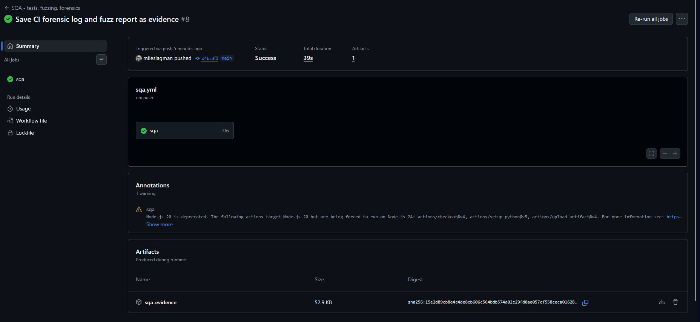
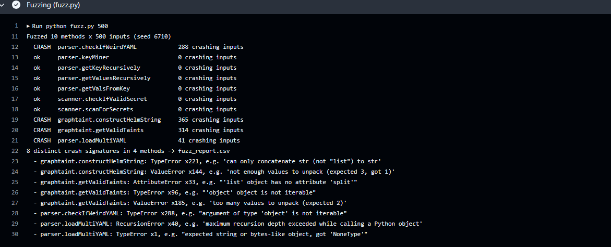
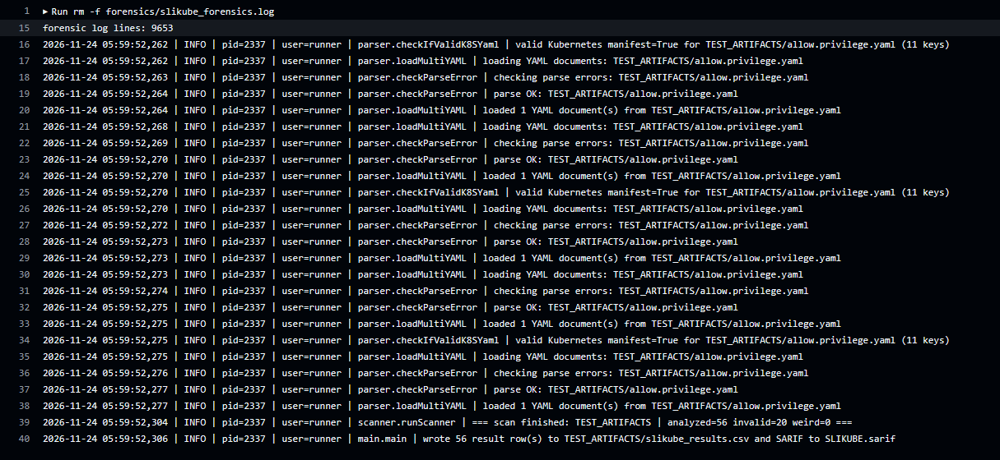
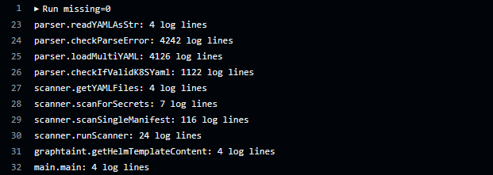

# SQA-REPO: Software Quality Assurance Report (COMP 5710/6710, Fall 2026)

**Team:** MILESLAGMAN (Miles Lagman)
**Project:** SLI-KUBE / KubeSec, a static security scanner for Kubernetes manifests (from `slikube.zip`)

## 1. Fuzzing (`fuzz.py`)

`fuzz.py` fuzzes 10 methods with random and mutated inputs. It uses a fixed seed (6710) so runs are reproducible, and it runs 500 inputs per method by default. Inputs include special strings (empty, NUL, 10k chars, path traversal, format strings, Unicode), random scalars of every type, random nested dict/list structures that look like parsed YAML, and mutated or random-byte YAML files. Each exception is grouped by method and exception type and written to `fuzz_report.csv`. A crash in a fuzzed method does not fail the script, so CI can upload the report; crashes are treated as findings. A copy of the report from CI is in `evidence/fuzz_report.csv`.

| # | Method | Result |
|---|--------|--------|
| 1 | `parser.checkIfWeirdYAML` | **crash**: `TypeError` on non-string input |
| 2 | `parser.keyMiner` | ok |
| 3 | `parser.getKeyRecursively` | ok |
| 4 | `parser.getValuesRecursively` | ok |
| 5 | `parser.getValsFromKey` | ok |
| 6 | `scanner.checkIfValidSecret` | ok |
| 7 | `scanner.scanForSecrets` | ok |
| 8 | `graphtaint.constructHelmString` | **crash**: `TypeError`/`ValueError` when the tuple is not a 3-tuple of strings |
| 9 | `graphtaint.getValidTaints` | **crash**: `ValueError`/`TypeError`/`AttributeError` on malformed match lists |
| 10 | `parser.loadMultiYAML` | **crash**: `RecursionError` and `TypeError` on *valid* YAML input (see below) |

### Bugs found
1. **Self-referential YAML anchor crashes the scanner (DoS).** A one-line manifest `&a [*a]` makes `parser.loadMultiYAML` → `find_json_path_keys` recurse until Python raises `RecursionError`. The exception is not caught by `runScanner`, so such a file aborts the whole scan. We wrote `&a [*a]` into the fuzzer's seed inputs as a suspected edge case, so this bug was confirmed by the fuzzer rather than discovered by random mutation (39 of the 40 crashes used that seed unmodified).
2. **Null mapping key crashes the scanner.** YAML such as `~: value` produces a `None` key, and `find_json_path_keys` calls `regex.match(None)`, which raises `TypeError`. Random mutation of a Pod manifest seed found this one: it inserted a newline before a colon, leaving an empty key (1 of 500 inputs).
3. **Missing input validation.** `checkIfWeirdYAML`, `constructHelmString` and `getValidTaints` assume a specific type or shape and raise when they get anything else.

Other defects found while setting up:
- `main.py` used `typer` and `Path` without importing them, so the tool and `TEST_INTEGRATION.py` failed at import. It also called `main()` directly instead of through `typer.run`, so the command-line argument was never parsed. We fixed both.
- `parser.show_line_for_paths` shells out to the undocumented external `yq` binary.
- `parser.show_line_for_paths` read `key_jsonpath_mapping[key]` in a debug `print` *before* the code checked whether the key exists. When run on the project's own `TEST_ARTIFACTS`, the full scan crashed with `KeyError: 'Unconfined'`. CI exposed this; we fixed it with `.get(key)`.
- Two Helm fixtures (`helm.values.yaml`, `helm.stackgres.yaml`) contained a real-format Grafana API key in a YAML comment, and GitHub push protection blocked the push. Because it was only in a comment, the scanner never saw it. We redacted it.
- Much of the original test suite fails outside the original author's computer. All 27 `TEST_GRAPH.py` tests fail on hard-coded paths (`/Users/arahman/...`, defined in `TEST_CONSTANTS.py`). In `TEST_SCANNING.py`, 64 of 115 tests error on a Windows machine without `yq`: 32 because an external program (`yq`) is missing, 26 because of the hard-coded paths, and 6 because of outdated tests (next item).
- Six `TEST_SCANNING.py` privilege tests are out of date: they unpack four values from `scanSingleManifest`, which returns three.

## 2. Forensics (`forensics.py`)

`forensics.py` provides a shared logger. Each log line records the timestamp, level, PID, OS user, the `module.function` that wrote it, and a message. Lines go to `forensics/slikube_forensics.log`; the `SLIKUBE_LOG` environment variable overrides the path. Secret *values* are never logged, only the key names where secrets were found.

The two Helm-related methods run only on a chart with a `templates/` folder, which `TEST_ARTIFACTS` does not have. We added a small chart with fake values in `SQA_FIXTURES/helm-demo`, and CI checks that all 10 methods write to the log and that the chart's fake password does not appear in it. A copy of the log from CI is in `evidence/slikube_forensics.log`.

Instrumented methods (10):

| # | Method | What is logged |
|---|--------|----------------|
| 1 | `parser.readYAMLAsStr` | file read and its size |
| 2 | `parser.checkParseError` | whether the parse succeeded, and files skipped |
| 3 | `parser.loadMultiYAML` | file loaded, YAML/Unicode errors, number of documents |
| 4 | `parser.checkIfValidK8SYaml` | Kubernetes-manifest classification and key count |
| 5 | `scanner.getYAMLFiles` | directory searched and number of YAML files |
| 6 | `scanner.scanForSecrets` | key names of hard-coded secret candidates (WARNING) |
| 7 | `scanner.scanSingleManifest` | secret, template and taint finding counts per manifest |
| 8 | `scanner.runScanner` | scan start/end, invalid and "weird" files skipped, totals |
| 9 | `graphtaint.getHelmTemplateContent` | Helm template directory and template count |
| 10 | `main.main` | tool invocation, target directory, output files |

## 3. Continuous Integration (`.github/workflows/sqa.yml`)

GitHub Actions runs on every push, on pull requests, and on manual dispatch:
1. Set up Python 3.11 and install the dependencies (`yq` is preinstalled on `ubuntu-latest`).
2. Run the unit tests (`TEST_PARSING.py`).
3. Run `fuzz.py`.
4. Run SLI-KUBE on `SQA_FIXTURES` and `TEST_ARTIFACTS`, which writes the forensic log.
5. Check that all 10 instrumented methods logged.
6. Upload `fuzz_report.csv`, the forensic log, the CSV/SARIF results and the scan output as the `sqa-evidence` artifact.

## 4. Lessons learned

**Fuzzing**
- **A simple fuzzer still confirms real bugs.** It runs in seconds, yet it showed two crashes reachable from YAML files: the self-referential anchor, which we had planted as a seed, and the null key, which mutation found. For a security scanner these are serious, because anyone who controls a single file in the scanned repository can abort the whole scan and hide every other finding.
- **The choice of inputs mattered.** Both crashes on YAML files came from `loadMultiYAML`, which was fuzzed with realistic YAML seeds. The random nested dict/list inputs found no crashes in the five methods that used them.
- **Not every crash has the same weight.** Most crash signatures came from passing the wrong type to internal helpers such as `constructHelmString`. Those show that the code has no defensive checks, but we did not show that a real manifest can trigger them. Separating "reachable from user input" from "caused by calling a helper with the wrong type" was needed to report the results honestly.
- **A fixed seed makes results reproducible**, so a crash seen in CI can be reproduced locally and the report numbers stay stable between runs.

**Forensics**
- **Deciding what to log is a design decision.** The most useful entries record decisions the tool makes on its own: which files were skipped as invalid or "weird", what each file was classified as, and how many findings each manifest produced. Without these, a scan that reports zero problems is indistinguishable from a scan that silently skipped everything.
- **Logs can leak secrets themselves.** `scanForSecrets` finds hard-coded passwords and tokens. Logging the values would copy those secrets into a log file that is uploaded as a CI artifact, so we log only the key names.
- **A central logger keeps logging consistent.** Putting the format (time, PID, user, method) in one module kept the 10 instrumented methods short and their output uniform.
- **Adding a log call is not the same as producing a log.** Our first version had logging code in 10 methods, but only 8 wrote anything in CI, because nothing in the test data exercised the other two. CI now checks this.

**Continuous integration**
- **CI ran code that local runs could not reach.** On our Windows machine the full scan stopped early because the code shells out to `yq`, an undocumented dependency that was not installed. The CI runner has `yq`, so the scan got further there and exposed a `KeyError` in `show_line_for_paths`.
- **Platform security checks are part of QA.** GitHub push protection blocked our first push because test fixtures contained a real-format API key. A tool meant to *detect* hard-coded secrets had shipped them in its own test data.
- **Treat fuzz crashes as findings in CI.** We made `fuzz.py` exit 0 and upload its report, rather than fail the build, because the known bugs are documented rather than fixed. Otherwise every build would be red and real regressions would be harder to notice.

**General**
- **Inherited code has inherited debt.** Before any new QA work, the project could not even start (`main.py` had missing imports), and most of the existing test suite depended on files from the original author's computer. Those tests check nothing on any other machine. Making the tests run anywhere is a prerequisite for every other QA activity.

## 5. Evidence / screenshots
The screenshots are from GitHub Actions run #8 (commit `d4bcdf0`). The files in `evidence/` were saved from the previous run (commit `d404c3a`), which ran the same code, so their timestamps differ.

**Continuous integration:** successful run with the uploaded `sqa-evidence` artifact.

**Fuzzing:** `fuzz.py` output in CI, with 10 methods and 8 distinct crash signatures.

**Forensics:** last lines of the forensic log from the scan.

**Forensics:** check that all 10 instrumented methods logged.

Full files: [forensic log](evidence/slikube_forensics.log), [fuzz report](evidence/fuzz_report.csv).
